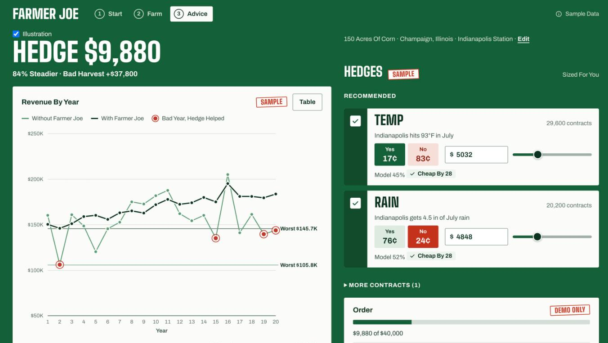
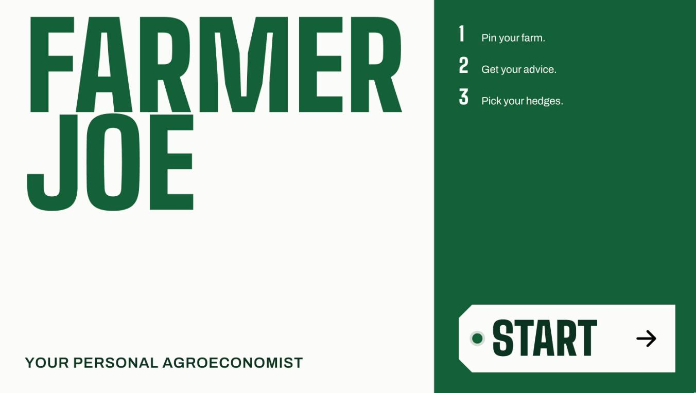
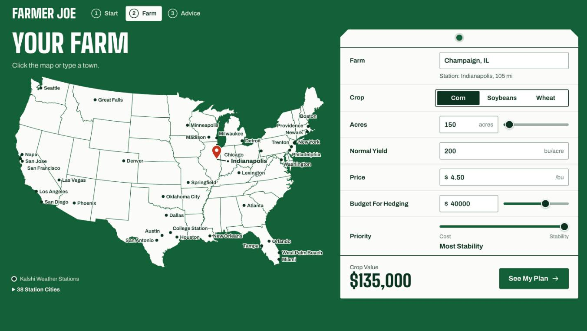

# Farmer Joe

**Hedge Advice For Farmers, Using Prediction Markets.**


*Advice Screen (Illustration Mode).*

A dry July, a heat wave or a price drop can wipe out a farm's year. Farmer Joe simulates 10,000
possible seasons for one specific farm and recommends which weather or crop-price contracts would
protect its income, or says that protection isn't worth buying.

## How It Works

| 1. Start | 2. Describe Your Farm |
|---|---|
|  |  |

1. **Describe Your Farm:** location, crop (corn, soybeans or wheat), acres, yield, price, budget.
2. **Simulate The Season:** 30 years of weather history become 10,000 possible seasons.
3. **Get Advice:** the few contracts that best protect your bad years, how many to buy, and the
   most to pay. Or "don't hedge."

## Example

**Dana grows 150 acres of corn near Champaign, Illinois** (200 bu/acre, $4.50/bu, $40,000 budget,
"Most Stability"). A normal year earns her about $124,000; a bad year (1 in 20), about $80,000.
Weather contracts in Indianapolis and Chicago, 105 and 129 miles away, barely track her farm, so
Farmer Joe recommends a **hedge** of about $35,600 in three corn-price contracts that pay if the
harvest price ends below $3.60, $4.05 or $5.40. Her bad-year income rises to about $97,000, her
year-to-year swing drops 43%, and the protection costs about $2,000 a year.

*Model output with placeholder yield and price settings; contracts are hypothetical.*

## Run It

```bash
python3 -m venv .venv && source .venv/bin/activate
pip install -r requirements.txt
python run.py --prewarm          # Optional: Cache The Demo Farms
uvicorn server:app --port 8000   # Then Open http://localhost:8000
```

## Limits

Contracts are hypothetical and no orders are placed. Yield and price settings are placeholders.
**Educational tool, not financial advice.**

## Team

Siddharth Tiwari, Lingbo Zhang, Rohan Yadav and Stéphanie Meylan, HackPrinceton Fall 2026.
